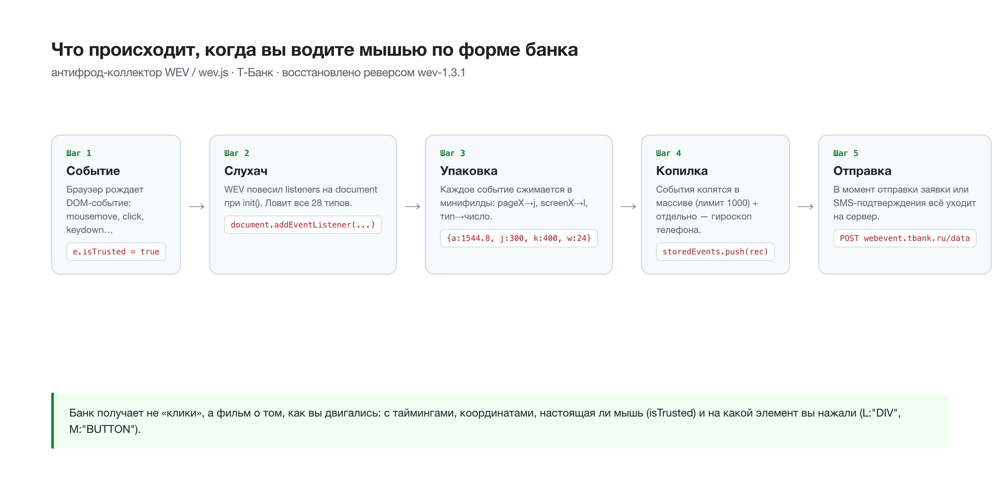
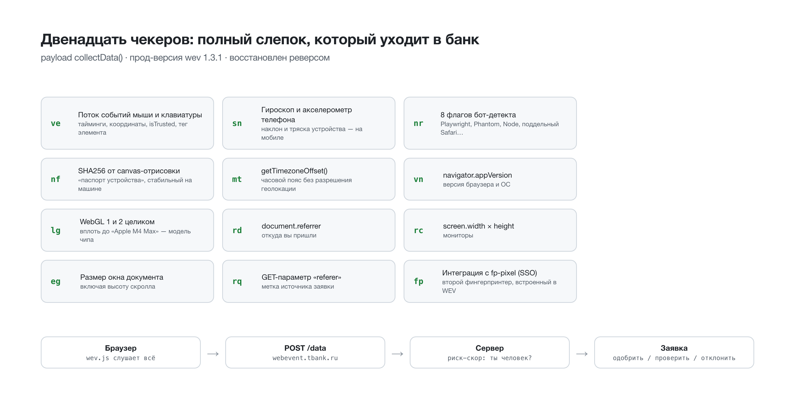
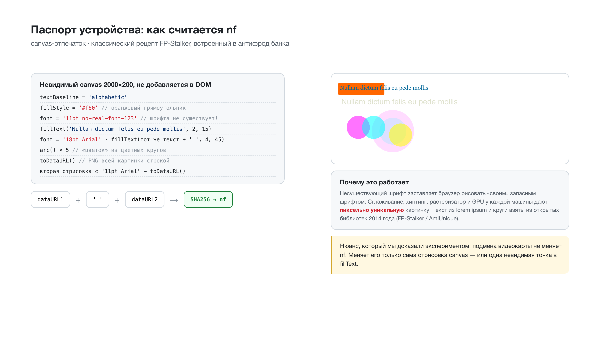
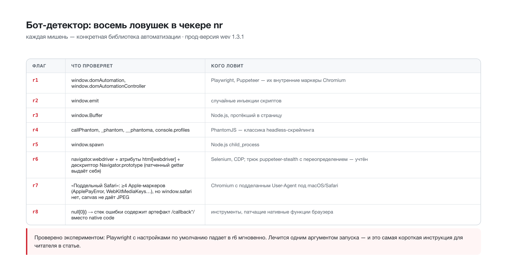

# Как Т-Банк узнаёт ваш компьютер: реверс антифрод-коллектора wev.js

Откройте форму заявки на дебетовую карту Т-Банка. Пока вы двигаете мышью,
ваш браузер рисует невидимую картинку 2000×200 пикселей. На ней текст
«Nullam dictum felis eu pede mollis» шрифтом, которого не существует,
и «цветок» из пяти цветных кругов. Картинка никуда не выводится, её
единственное назначение: превратиться в строку и сложиться в SHA256-хеш.
Этот хеш, `nf`, и есть паспорт вашего компьютера.

Я реверсил этот коллектор неделю и расскажу, что именно банк знает о вашем
браузере, как он ловит ботов и почему подмена видеокарты ему не мешает.

## Откуда мы это знаем

Заявки на карты живут не на главной, а в отдельных микроформах. В одном из
бандлов, `form-growth-black.client.js`, нашёлся `antifraudPlugin`: конфиг
из 28 типов DOM-событий, списка чекеров и адреса SDK
`acdn.tinkoff.ru/params/common_front/resourses/security/wev-1.2.0.js`.

Сам SDK весит 165 КБ и упакован обфускатором obfuscator.io: строковый массив,
ротация, арифметика вроде `-0x376 + -0x1*0xc61 + 0x17a7*0x1` вместо числа 592.
Я развернул строковый массив через песочницу, свернул выражения и склеил
разрезанные строки. А потом пошёл проще и надёжнее: запустил скрипт на
локальной странице с оригинальным конфигом и вызвал `wev.collectData()`
напрямую. Живой объект оказался честнее статического разбора.

Прод-версия, кстати, отличается: на странице заявки грузится `wev.js`
версии 1.3.1 со хоста `sso-captcha-0.t-static.ru/webspy/wev.js`. Она компактнее
(100 КБ) и без obfuscator.io. Написать антифрод, который потом не стыдно
читать, похоже, считается нормой.

## Фильм вместо лога

`collectData()` возвращает двенадцать блоков. Главное в них:

- **ve**: поток событий. Каждое движение мыши и каждое нажатие клавиши
  сжимается в минифилды: `pageX` превращается в `j`, `screenX` в `l`,
  тип события в число (`click` это 4, `mousemove` это 24). Поля формы
  защищены: в парольном инпуте уходит только код клавиши, не символ.
  За 15 секунд возни с формой набирается около 170 событий.
- **lg**: WebGL целиком, обе версии контекста. Пределы текстур, точность
  шейдеров, 39 расширений и, главное, `UNMASKED_RENDERER`. На моей машине
  банк видит «ANGLE Metal Renderer: Apple M4 Max». То есть модель чипа.
- **sn**: гироскоп и акселерометр. На десктопе пусто, на телефоне банк
  видит, как вы держите и трясёте устройство.
- **mt, rc, eg, rd, rq**: часовой пояс, мониторы, размер окна, referrer
  и GET-параметр источника заявки.

Собранное уходит на `webevent.tbank.ru/data` не сразу: лёгкий POST с меткой
`load` летит при загрузке формы, а полный payload с потоком событий
отправляется в момент подачи заявки или SMS-подтверждения. Триггеры видны
в коде плагина: `ADD_APPLICATION_HAS_SUCCEED` и `onConfirmSMS`.

## Паспорт: из чего складывается nf

Перехватив прототип `CanvasRenderingContext2D`, я восстановил точный рецепт:

1. холст 2000×200, `textBaseline: alphabetic`;
2. оранжевый прямоугольник `#f60`;
3. текст «Nullam dictum felis eu pede mollis» шрифтом `11pt no-real-font-123`.
   Шрифта с таким именем нет ни в одной системе, поэтому браузер рисует
   своим запасным шрифтом. Хинтинг, сглаживание и растеризатор дают
   пиксельно уникальный результат на каждой машине;
4. тот же текст полупрозрачным цветом в `18pt Arial`, с хвостовым пробелом;
5. пять дуг: `rgb(255,0,255)`, `rgb(0,255,255)`, `rgb(255,255,0)` и две
   дуги поменьше поверх;
6. `toDataURL()` дважды, вторая отрисовка с обычным Arial;
7. `nf = SHA256(dataURL1 + '_' + dataURL2)`.

Рецепт классический, он из открытых библиотек 2014 года (FP-Stalker,
AmIUnique). Банк не изобретал технику, он встроил проверенную в прод.

## Восемь ловушек для ботов

Чекер `nr` возвращает восемь булевых флагов, и каждый целится в конкретный
инструмент: `domAutomation` выдаёт Playwright и Puppeteer, `Buffer` и `spawn`
протёкший Node.js, `callPhantom` выдаёт PhantomJS. Самый интересный пара:

- **r6**, webdriver: проверка идёт по `navigator.webdriver`, по атрибутам
  `html[webdriver]`, `html[driver]` и по дескриптору `Navigator.prototype`.
  Если stealth-плагин переопределил getter, он
  оставляет след: исходник функции перестаёт быть `[native code]`.
- **r7**, поддельный Safari: браузер, в котором есть четыре и больше
  Apple-маркеров (`ApplePayError`, `WebKitMediaKeys`, vendor «Apple»),
  обязан иметь `window.safari` и canvas, умеющий JPEG в Safari-стиле.
  Chromium с подделанным User-Agent проваливает проверку.
- **r8**, патченные нативные функции: скрипт вызывает `null[0]()`, ловит
  TypeError и смотрит на стек. Честный Chrome пишет `[native code]`,
  инструменты-патчеры оставляют артефакт `/callback*/`.

Проверил на практике: Playwright с настройками по умолчанию падает в r6
мгновенно. Лечится одним аргументом запуска:
`--disable-blink-features=AutomationControlled`.

## Эксперименты со спуфом

Тут самое интересное. Я предположил, что nf зависит от видеокарты, и
подменил `UNMASKED_RENDERER` через патч `getParameter`: вместо Apple M4 Max
банк увидел GeForce RTX 4090. Хеш не сдвинулся ни на бит. WebGL уходит
отдельным блоком `lg`, но в nf не входит.

Зато патч самого canvas меняет всё. Добавил к каждому `fillText` невидимую
точку с фиксированным сдвигом: nf стал другим. А если добавить точку со
случайным сдвигом, nf начинает меняться на каждый вызов, и это маркер:
у настоящей машины canvas стабилен, у браузера с анти-фингерпринт плагином
пляшет. Стабильный спуф выглядит так: сдвиг детерминированный, тогда банк
видит другое устройство вместо вашего. Без смены железа.

## Второй коллектор

На страницах SSO (вход по T-ID) грузится ещё один скрипт, `fp-pixel.js`.
Он весит 186 КБ и снимает уже всё сразу: canvas, WebGL, audio, шрифты,
батарею, touch, WebRTC, таймзону. Отправляет на отдельный сервис
`web2web.tbank.ru/web-fingerprint/api/v1/external/fingerprint`. В версии
WEV 1.3.1 появился чекер `fp`, который вызывает этот модуль прямо из
коллектора. Два фингерпринтера на одну компанию, и они скооперировались.

## Что с этим делать

- Если вы пользователь: ваш браузер честно рассказывает банку про модель
  чипа, скорость мыши и то, настоящая ли она. Инкогнито тут не помогает.
- Если вы автоматизируете: аргумент `--disable-blink-features=AutomationControlled`
  закрывает r6, дальше смотрят на поведение. Робот, который двигает мышь
  по прямой с постоянной скоростью, читается мгновенно.
- Если вы делаете свой продукт: техники публичные, рецепт nf лежит в
  открытых исследованиях, а формат данных каждый выбирает сам. Я собрал
  чистую реализацию [FPX](https://github.com/s1rne/fpx-fingerprint) без обфускации: canvas,
  WebGL, audio, behavioral-поток и восемь бот-детектов в 300 строках кода.

Исходники реверса, журнал с таймстампами и все эксперименты лежат рядом
со статьёй. Вторая часть, про fp-pixel и SSO-фингерпринт, уже пишется.
